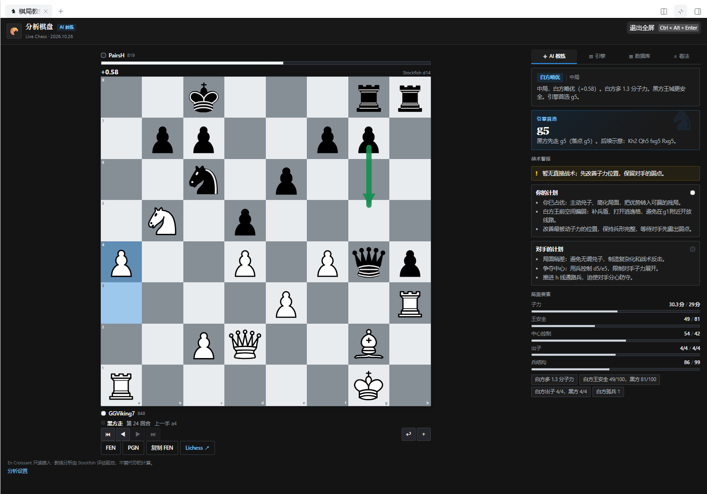
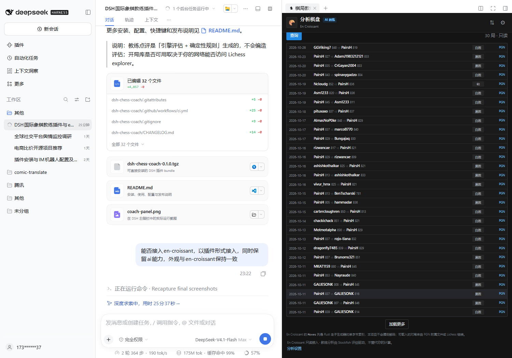
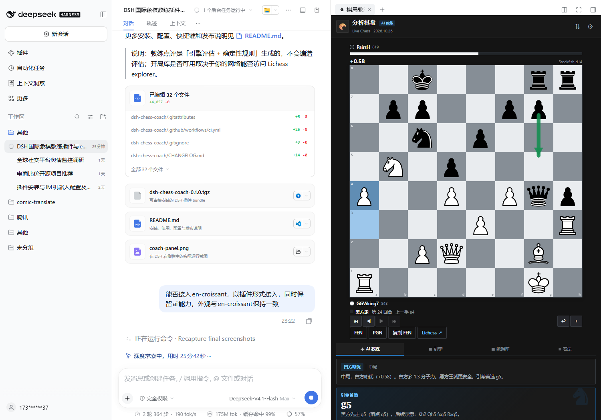
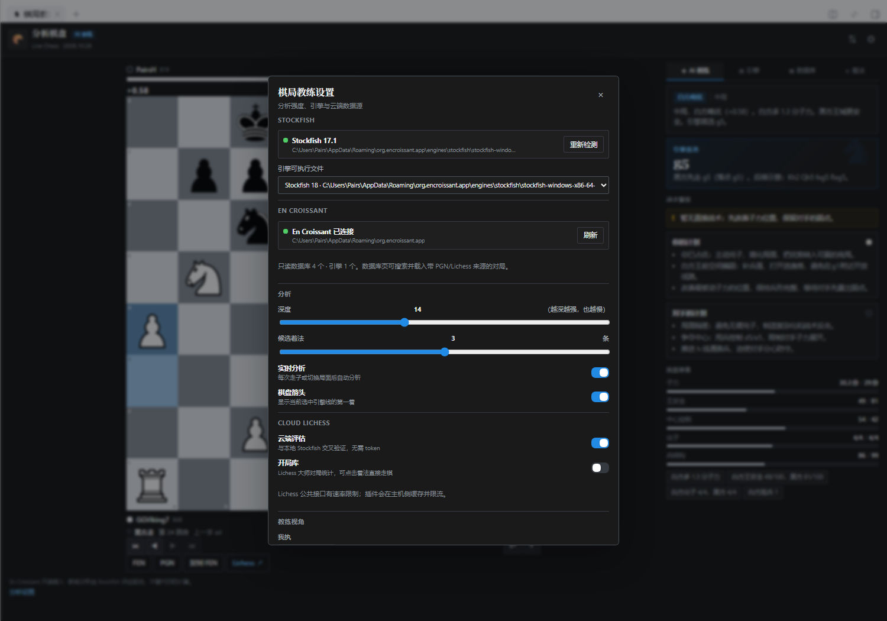

# dsh-chess-coach

A chess study panel for the DeepSeek Harness right sidebar, now with an **En Croissant-style interface and a read-only En Croissant data bridge**, while keeping the AI coach.



## En Croissant integration

En Croissant is a Tauri desktop app with no HTTP/CLI API; embedding its whole window would require porting dozens of Tauri commands. This plugin integrates at the file level instead:

- **Engines**: reads `engines/engines.json` and merges local En Croissant engines (Stockfish, RubiChess) into the engine picker.
- **Databases**: enumerates `db/*.db3` read-only, reads `Info`, and searches White/Black/Event/Result headers in `Games`.
- **Game loading**: matches a game in the `.pgn` sidecar, or fetches it from Lichess when `Site` contains a Lichess game URL.
- **Launch**: an "Open application" action starts the detected En Croissant executable.
- **Appearance**: dark Mantine-like surfaces, `#e9ecef/#868e96` gray board, cburnett pieces, tabbed analysis panel, and a two-column board/analysis layout in fullscreen.

The binary `Games.Moves` BLOB is deliberately not decoded: it is a one-byte legal-move index whose ordering belongs to En Croissant's Rust move generator. Guessing it would silently load the wrong game. The `.pgn` sidecar is an import-time snapshot and may drift; failures are reported explicitly.

## Features

- Interactive board with click/drag, legal targets, promotion, last-move/check highlights, flip, player bars.
- Live local Stockfish UCI analysis with MultiPV, depth, nodes, NPS, and White-POV score.
- AI coach: summary, plans for both sides, tactical alerts, king safety, centre, development, pawn structure, engine recommendation and continuation.
- En Croissant database browser with filters and PGN/Lichess game loading.
- FEN load, PGN import/export, copy FEN, move navigation, undo, Lichess analysis link.
- Optional Lichess cloud evaluation and opening explorer.
- Per-conversation study persistence and session isolation.

## Screenshots







## Requirements

- DSH `>=0.2.2-rc.1 <0.3.0`
- Node.js `>=20`; the En Croissant database bridge uses `node:sqlite` (Node 22.5+; DSH Desktop currently runs Node 24)
- En Croissant 0.15.x is optional; only the legacy `db3` format is read
- Stockfish 16/17 recommended

## Install

```sh
dsh plugin --profile <profile> add dsh-chess-coach
# or a local tarball
pnpm build && pnpm pack
dsh plugin --profile <profile> add ./dsh-chess-coach-0.2.0.tgz
```

The Desktop `desktop` profile is managed by Electron; install through the Plugins page or the local bundle installer.

## Use

Open a conversation, expand the right sidebar, and choose **棋局教练** on the guide page. Tabs: **AI coach / Engine / Database / Moves**. The fullscreen right sidebar switches to a board + analysis two-column layout.

## Configuration

```yaml
- id: dsh-chess-coach
  name: dsh-chess-coach
  config:
    enginePath: 'C:\Program Files\Stockfish\stockfish.exe' # optional
    threads: 4
    hashMb: 256
    defaultMultipv: 3
    enCroissantDataDir: 'C:\Users\<you>\AppData\Roaming\org.encroissant.app'
    enCroissantAppPath: 'D:\en-croissant\en-croissant.exe'
```

## Security and privacy

- En Croissant files are opened read-only; the plugin never writes `.db3`, `.ecsi`, `.pgn`, or En Croissant settings.
- Host routes are same-origin and fenced; bodies are capped at 64 KiB; database names reject path separators; engine paths are allow-listed; launching uses a fixed executable and no shell.
- Local Stockfish makes no network requests. FENs are sent to Lichess only when cloud features are enabled.

## Development

```sh
pnpm install
pnpm typecheck
pnpm test
pnpm build
pnpm pack
```

The test suite has 15 tests, including a real Stockfish integration test and an En Croissant file-bridge test that skips when En Croissant is not installed.

## Limitations

- En Croissant 0.15.x legacy databases; Database v2/DuckDB is not supported yet.
- The `Moves` BLOB is not decoded; games without a PGN sidecar or Lichess URL show metadata only.
- Lc0 is hidden because it needs weights/backend arguments not present in `engines.json`.
- Deterministic coaching, not an LLM narrative; no online play or spaced-repetition training.

## License

MIT for the code. The cburnett piece artwork is GPL-2.0-or-later (Colin M.L. Burnett); see [`LICENSES/GPL-2.0.txt`](LICENSES/GPL-2.0.txt) and [`THIRD_PARTY_NOTICES.md`](THIRD_PARTY_NOTICES.md). En Croissant is a separate GPL-3.0 project and is not bundled or affiliated. Stockfish is a separate GPLv3 executable invoked over UCI.
