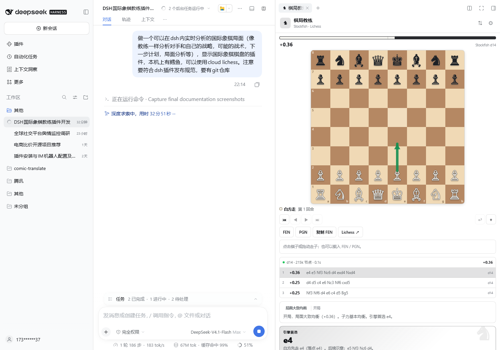

# dsh-chess-coach

A chess study and coaching panel for the DeepSeek Harness right sidebar.

It combines an interactive board, a live local Stockfish engine, and a deterministic coach report: opening/middlegame/endgame assessment, plans for both sides, tactical alerts, king safety, pawn structure, centre control, and the engine's recommended continuation. Optional Lichess cloud evaluation and opening explorer are available without an API token.



## Highlights

- Interactive board: click or drag, legal-target hints, promotion picker, last-move and check highlights, board flip.
- Live Stockfish UCI analysis with MultiPV, depth, nodes, NPS, and White-POV scores.
- Coach report: summary, engine choice, tactical alert, White plan, Black plan, five positional metrics, and concrete facts.
- Study tools: FEN load, PGN import/export, copy FEN, move history navigation, undo, Lichess analysis link.
- Optional Lichess cloud-eval and masters opening explorer; host-side proxy, throttling, and cache.
- Local-first: no network calls unless cloud features are enabled.

## Requirements

- DSH `>=0.2.2-rc.1 <0.3.0`
- Node.js `>=20`
- Stockfish 16/17 is recommended for local analysis; the board and manual play still work without it.

The host auto-detects Stockfish from `enginePath`, `DSH_CHESS_STOCKFISH`, `STOCKFISH_BIN`, En Croissant's engine directory on Windows, `PATH`, and common install locations. The plugin settings let you pick any discovered executable.

## Install

```sh
# after publishing to npm
dsh plugin --profile <profile> add dsh-chess-coach

# local tarball
pnpm build && pnpm pack
dsh plugin --profile <profile> add ./dsh-chess-coach-0.1.0.tgz
```

The Desktop `desktop` profile is managed by the Electron app; install through the Plugins page or the local bundle installer instead of the CLI.

## Open it

1. Open a conversation.
2. Expand the right sidebar.
3. On the guide page, choose **棋局教练** (Chess Coach).
4. Play on the board, or load a FEN/PGN.

Keyboard: `←`/`→` previous/next move, `Home`/`End` start/latest, `F` flip, `Esc` close dialogs.

## Configuration

```yaml
- id: dsh-chess-coach
  name: dsh-chess-coach
  config:
    enginePath: 'C:\Program Files\Stockfish\stockfish.exe' # optional
    threads: 4
    hashMb: 256
    defaultMultipv: 3
```

`cordis.patch.yml` replaces a row's whole `config`; repeat every key you need.

## Security notes

- Host routes live under the same-origin `/chess-coach/api/*` prefix; they reject cross-site requests, cap bodies at 64 KiB, and never accept an arbitrary executable path from the browser.
- `/engine/select` only accepts paths the host discovered itself. `enginePath` can only come from the profile config.
- Stockfish is spawned without a shell. A newer analysis cancels the previous search and analyses are serialised through one engine.
- Lichess calls are proxied by the host with a 350 ms throttle and a five-minute cache. Disable cloud features to make the plugin fully offline.

## Development

```sh
pnpm install
pnpm typecheck
pnpm test
pnpm test:engine
pnpm build
pnpm pack
```

The layout is one host ESM entry (`lib/index.js`) plus one DSH lazy-CJS browser factory (`lib/client.js`). `dsh.bundle` contributes the `cordis.patch.yml` row; `dsh.client` declares the web platform and the sidebar injection; `exports` and `files` are limited to the published artifacts and metadata.

## Limitations

- One engine process and one live search; very fast move bursts settle on the latest position.
- The Lichess opening explorer can return 401 on restricted networks; it is off by default and never blocks local analysis.
- No online play, clock, engine-vs-engine, or cloud sync. Games are persisted per conversation in `localStorage`.
- PGN mainline only; variations/comments/NAGs are not preserved.

## License

MIT. chess.js is BSD-2-Clause. Stockfish is a separate GPLv3 executable invoked over UCI and is not redistributed here. Lichess data is subject to Lichess's terms and rate limits.
