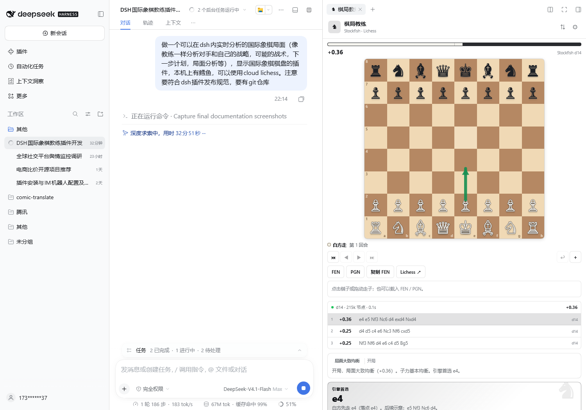
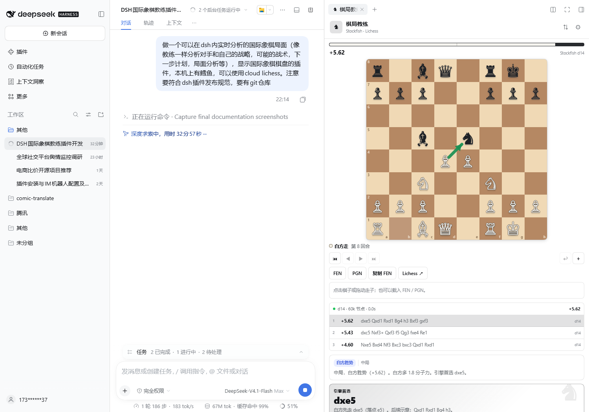
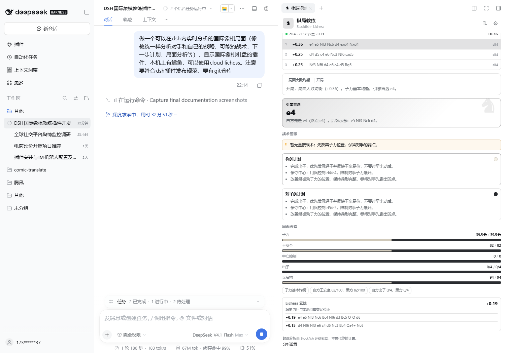

# dsh-chess-coach

在 DeepSeek Harness 右侧栏里下棋、看棋、复盘。

交互棋盘 + 本地 Stockfish 实时分析 + 教练式局面解读：不只告诉你「引擎走什么」，还会拆出双方的战略计划、战术警报、王安全、兵形、中心和下一步方案。可选接入 Lichess 云端评估与开局库。



## 功能

- **可交互棋盘**：点击或拖拽走子，合法着法提示、升变选择、上一步高亮、将军高亮、翻转棋盘。
- **实时 Stockfish**：本地 UCI 引擎常驻，走子后自动分析；MultiPV 候选着法、深度、节点数、耗时、白方视角评分。
- **教练式解读**：
  - 一句话局面总结与优势判断；
  - 「引擎首选」与后续变化；
  - 战术警报：悬子、将军、将杀、叉子、升变、底线与王前线路；
  - 双方计划：出子、中心、王安全、通路兵、开放线、兑子取舍；
  - 局面指标：子力、王安全、中心控制、出子、兵结构。
- **双方视角**：设置「我执白 / 我执黑」后，分别展示「你的计划」与「对手的计划」；白黑双方分析始终保留。
- **研究工具**：FEN 载入、PGN 导入/导出、复制 FEN、回看/撤销着法、跳转 Lichess 分析。
- **Cloud Lichess（可选）**：Lichess 云端评估交叉验证；大师开局库可点击着法直接走棋。无需 API token。
- **本地优先**：不联网也能用；只有开启云端功能时，当前 FEN 才会发送给 Lichess。

### 一个战术局面



## 环境要求

| 项目 | 要求 |
| --- | --- |
| DSH | `>=0.2.2-rc.1 <0.3.0`（使用 DSH 原生右侧栏的 Tab 扩展点） |
| Node.js | `>=20` |
| Stockfish | 推荐 16/17；非必需，但本地实时分析需要它 |
| 浏览器 | DSH Web / Desktop 当前 Chromium 内核 |

### Stockfish 自动检测顺序

1. `enginePath`（`cordis.patch.yml` 配置）
2. 环境变量 `DSH_CHESS_STOCKFISH` / `STOCKFISH_BIN`
3. `PATH` 中的 `stockfish`
4. 常见安装位置（Windows / macOS / Linux）

如果自动检测不到，可以在插件设置里手动选择，或在 `cordis.patch.yml` 的 `enginePath` 中填写绝对路径。

## 安装

### 从 npm（发布后）

```sh
dsh plugin --profile <profile> add dsh-chess-coach
```

### 本地 tarball

```sh
pnpm build
pnpm pack
# 在 DSH 的「插件」页选择本地 tarball 安装，或：
dsh plugin --profile <profile> add ./dsh-chess-coach-0.3.0.tgz
```

Desktop 的 `desktop` profile 由 Electron 管理，命令行 `dsh plugin` 会拒绝修改；请使用 DSH 设置里的插件安装入口，或本仓库开发时使用的 `plugin_manager` 本地 bundle 安装。

### 本地开发（link）

```sh
dsh plugin --profile web add link:/absolute/path/to/dsh-chess-coach
```

profile 需要声明 `react` peer 的宿主实例；安装时 DSH 会处理。重新构建后刷新页面，Client bundle 会通过 DSH 的 HMR 重新加载；Host 路由变更需要重载插件或重启 DSH。

### Git 安装

```sh
dsh plugin --profile web add github:<you>/dsh-chess-coach#<commit>
```

仓库带有 `prepare: tsdown`，pnpm 会在 git 安装后从源码构建 `lib/`。pnpm 10+ 首次会要求你在 profile 的 `pnpm-workspace.yaml` 中授权 `allowBuilds`；只对可信源码授权，并锁定 commit。

## 使用

1. 打开一个会话。
2. 展开右侧栏；如果没有打开任何页面，会显示指南页。
3. 在指南中点击 **棋局教练**（♞）。
4. 直接在棋盘上走子，或点 **FEN / PGN** 载入局面。



### 快捷键

| 操作 | 按键 |
| --- | --- |
| 上一步 / 下一步 | `←` / `→` |
| 跳到开局 / 最新 | `Home` / `End` |
| 翻转棋盘 | `F` |
| 关闭弹窗 | `Esc` |

### 设置

右上角 ⚙：

| 设置 | 默认 | 说明 |
| --- | --- | --- |
| 深度 | 14 | 8–24；越深越强，也越慢 |
| 候选着法 | 3 | 1–5 条 MultiPV |
| 实时分析 | 开 | 走子后约 320 ms 防抖自动分析 |
| 棋盘箭头 | 开 | 显示选中引擎线的第一着 |
| 云端评估 | 开 | Lichess cloud-eval，失败时不影响本地分析 |
| 开局库 | 关 | Lichess masters explorer；部分网络会返回 401，开启前请确认网络可达 |
| 我执 | 白方 | 切换「你的计划 / 对手的计划」视角 |

## 配置 `cordis.patch.yml`

插件 bundle 的默认层已经带好常用值；需要覆盖时，在 profile 的 `cordis.patch.yml` 中按行 id 覆盖：

```yaml
- id: dsh-chess-coach
  name: dsh-chess-coach
  config:
    # 不在自动检测路径中时填写；空字符串/省略表示自动检测
    enginePath: 'C:\Program Files\Stockfish\stockfish.exe'
    threads: 4
    hashMb: 256
    defaultMultipv: 3
```

注意 patch 会替换整段 `config`，不是深合并；覆盖时把需要的键都写上。

## 安全与边界

- Host 只在 `webServer` 上注册同源 JSON 路由：`/chess-coach/api/*`；检查 `Host`/`Origin` 与 `sec-fetch-site`，请求体上限 64 KiB。
- 浏览器不能传任意可执行文件路径。`/engine/select` 只接受服务端自己发现的候选路径；`enginePath` 只能由 profile 配置提供。
- Stockfish 由 `child_process.spawn` 直接启动，不经过 shell。
- 每次分析会取消上一轮搜索，避免堆积过期请求；并发请求串行进入引擎，最多一个活跃搜索。
- Lichess 请求由 Host 代理（避开 CORS），带 350 ms 间隔限流与 5 分钟缓存；关闭云端功能后不会发起任何网络请求。
- 教练文字是确定性规则 + 引擎评估，不会凭空编造评估；它不等同于人类大师的完整判断。

## 开发

```sh
pnpm install
pnpm typecheck
pnpm test          # 单元测试 + 本机 Stockfish 集成测试
pnpm test:engine   # 只跑 Stockfish 集成测试
pnpm build         # lib/index.js (ESM host) + lib/client.js (DSH lazy-CJS browser bundle)
pnpm pack
```

测试若找不到 Stockfish，会自动跳过集成测试；设置 `DSH_CHESS_STOCKFISH` 可指定引擎。

### 结构

```
src/
  index.ts              Host 插件：路由、生命周期
  host/
    engine.ts           Stockfish UCI 常驻进程、取消/串行、候选检测
    coach.ts            FEN 事实 + 引擎线 → 教练报告
    lichess.ts          cloud-eval / opening explorer 代理、限流、缓存
  shared/types.ts       Host ↔ Client 的 wire types
  client/
    index.tsx           DSH 右侧栏 type/body/title 注册
    ChessCoach.tsx      棋局状态、分析调度、布局
    Board.tsx           8×8 棋盘、拖拽/点击、箭头
    CoachPanel.tsx      教练卡片
    Dialogs.tsx         设置/FEN/PGN/升变
    styles.ts           作用域样式
tests/                  规则、UCI 转换、PGN、Stockfish 集成
```

### 与 DSH 发布规范对应

- `package.json` 的 `dsh.bundle.patch` → `cordis.patch.yml`，安装后向 profile 插入一行 `dsh-chess-coach`。
- `dsh.client` 声明 `platform: "web"`、`inject` 与 `exports["./client"]`；Client bundle 是 DSH Module Loader 的 lazy-CJS factory，React 从平台共享表解析，其余依赖内联。
- `files` 白名单只发布 `lib/`、patch、manifest、README、LICENSE、icon。
- `engines.dsh` 限制 DSH 兼容范围；`peerDependencies` 只声明共享 React。
- Host 端不静态 import 任何 `@deepseek-ai/dsh-*` 运行时包，保持对宿主版本的松耦合；Client 端只使用 DSH 公开的 slot/tab 注册面。
- `dsh.plugin.json` 提供插件市场的 id/version/main/client 元数据。

## 已知限制

- 单引擎单进程；同时只保留一个分析，深度很高时高频走子会以最新局面为准。
- 云端开局库在部分网络会 401/超时；默认关闭，失败不会影响本地引擎。
- 没有在线对战、时钟、引擎对战或云同步；棋局按会话保存在浏览器 `localStorage`。
- 教练规则覆盖常见战术与结构，但不是完整的局面理解模型；关键决定仍应自己计算。
- PGN 变例、评论和 NAG 不会完整保留；导入/导出主线着法。

## License

MIT。内置的 [chess.js](https://github.com/jhlywa/chess.js) 使用 BSD-2-Clause；Stockfish 是独立的 GPLv3 程序，本项目只通过 UCI 调用用户本机的 Stockfish，不打包其二进制。Lichess 数据的使用受 Lichess 服务条款与速率限制约束。
